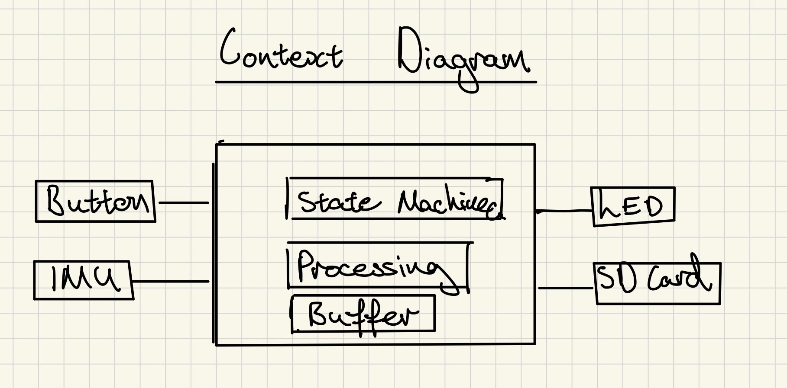
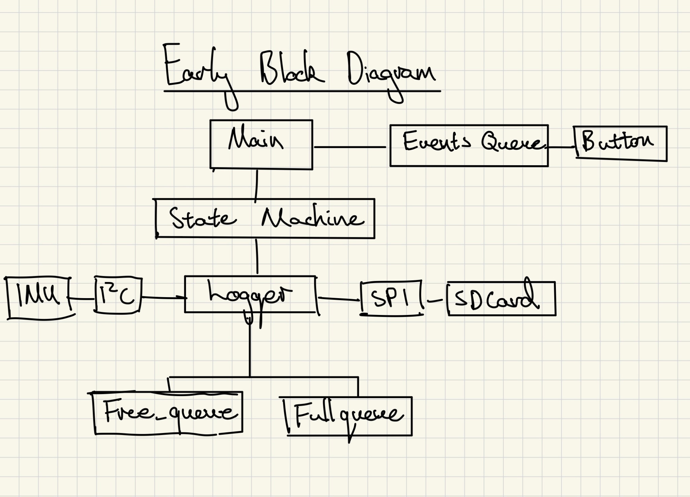

# Rocky telemetry

Rocky telemetry records motion data from an MPU6050 to an SD card, targeting
1,000 samples per second. A button starts and stops logging; an LED shows the
current state.

The sensor's small FIFO and variable SD write latency shaped the design. Core 0
handles acquisition and events. Core 1 processes and writes filled buffers. A
fixed pool of four RAM buffers and free/full queues transfers ownership between
the cores, keeping slow storage operations away from acquisition.

The software separates `Inputs`, `SampleProcessor`, `Outputs`, and `EventSource`
interfaces. Main selects concrete implementations and injects their dependencies;
`Logger` implements the `Process` interface used by the state machine. This makes
individual parts easier to test and replace without redesigning the whole logger.

The default processor passes raw accelerometer and gyroscope records through
unchanged. Host tests and the firmware build pass; sustained sampling, storage
latency, and overflow behaviour still need validation on hardware.

## Early sketches

*1. Context sketch: inputs, processing, buffering, and outputs.*

*2. Block sketch: the logger, event queue, hardware buses, and free/full queues.*

Current architecture diagrams

[Design evolution and data format](docs/design-evolution.md) ·
[Tests and interface contracts](tests/README.md)
