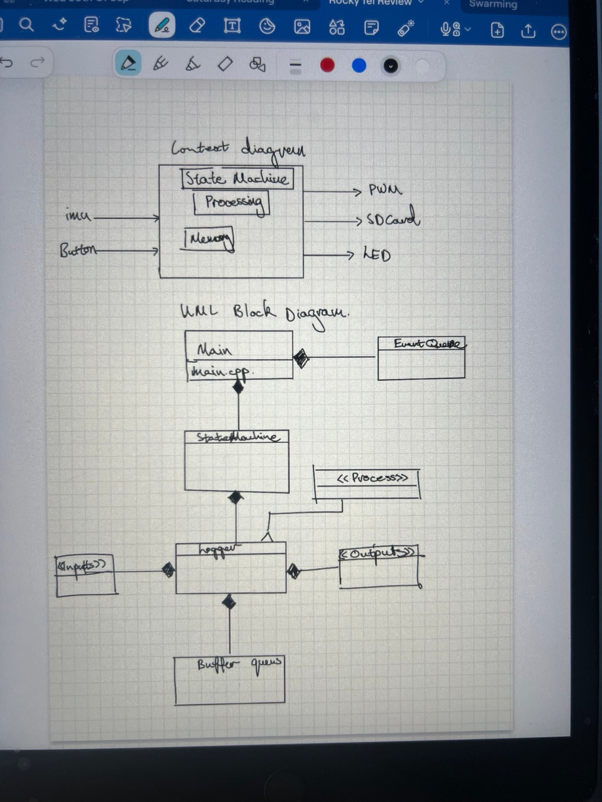
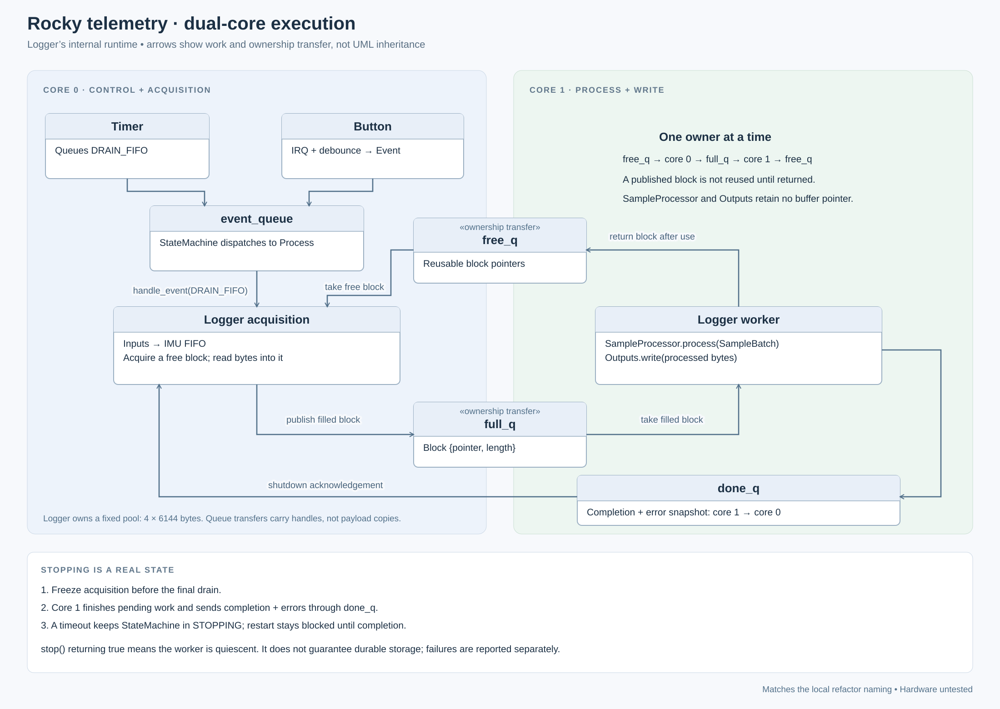
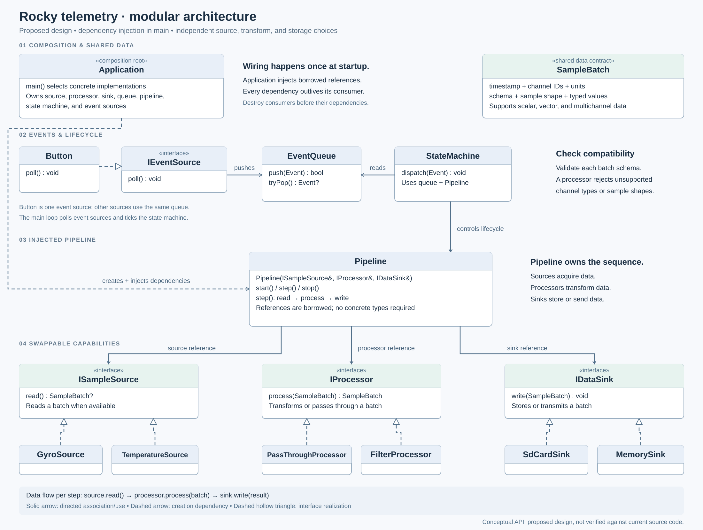
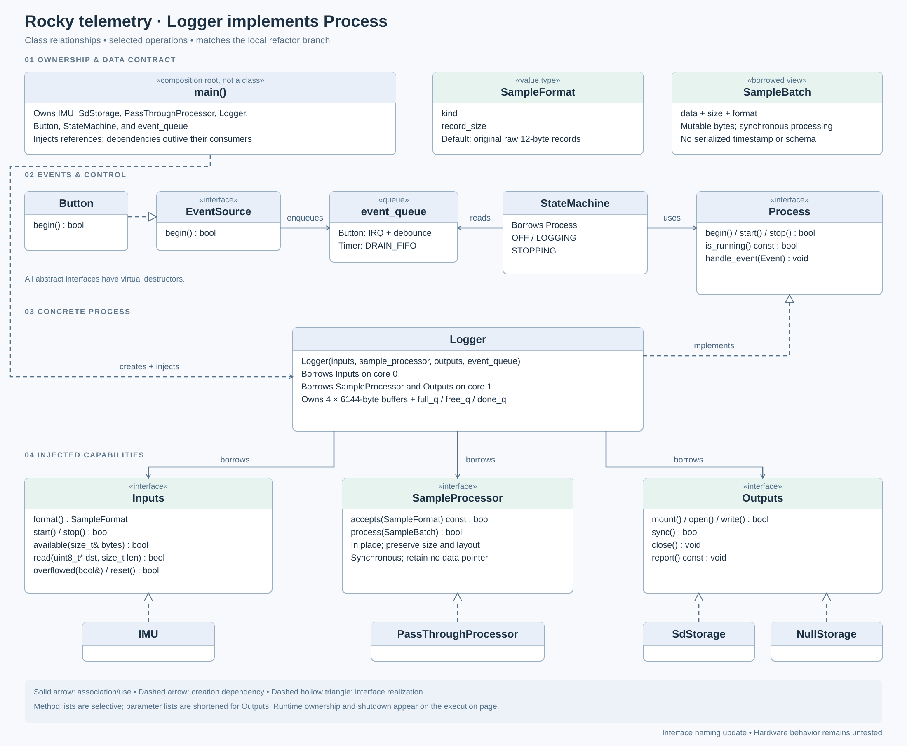

# Design evolution

Embedded data-logging software for the Rocky helmet testing rig. A design reference
for this project is *Making Embedded Systems* by Elecia White.

When I start a new project, I like to begin with a context diagram. The initial
idea was simple: sample an MPU6050 at around 1,000 Hz and write the data to an SD
card.

*Interim screenshot, to be replaced when the original hand-drawn images are
uploaded. It includes possible outputs such as PWM, not all of which are
implemented.*

A basic version could come together fairly quickly. I wanted to use this project
to practise designing software around real timing constraints, while making it
easier to change individual parts later.

The first additions were straightforward: a button to start and stop logging,
and an LED to show the current state. The timing requirements needed more
thought. The MPU6050 has a 1,024-byte FIFO. With the temperature channel excluded,
each accelerometer-and-gyroscope sample occupies 12 bytes. That leaves room for
85 complete samples, or roughly 85 ms of data at 1,000 Hz. The processor therefore
needs to drain the FIFO regularly.
[MPU6050 datasheet](https://invensense.tdk.com/wp-content/uploads/2015/02/MPU-6000-Datasheet.pdf)

SD writes introduce a different timing constraint. Cards use 512-byte blocks,
and write latency varies. A typical write time would not be a safe worst-case
assumption, so I wanted RAM buffering between acquisition and storage.
[SD Association specification](https://www.sdcard.org/cms/wp-content/themes/sdcard-org/dl.php?f=Part1_Physical_Layer_Simplified_Specification_Ver6.00.pdf)

I chose to split the work across the Pico's two cores. Core 0 handles acquisition
and events. Core 1 consumes filled buffers, runs an optional in-place processing
stage, and writes the results synchronously to the output. A fixed buffer pool
and free/full queues transfer buffer ownership between the cores. Multicore
execution is one way to make this separation; it is not a requirement imposed
by the sample rate alone.

[Execution diagram as SVG](images/rocky_telemetry_v3_execution.svg)

The pool contains four 6,144-byte buffers. Each holds 512 samples and is a
multiple of the SD block size. Together, they provide nominal storage for
2,048 samples, about 2.048 seconds at the target rate. That describes capacity,
rather than a guaranteed tolerance for storage stalls: available headroom
depends on how many buffers are already occupied.

I also wanted to think beyond the first version. At work, I regularly use
software that has accumulated years of changes. What happens when I want a
different sensor, another logging destination, a different event trigger, or
an onboard filter?

*Historical proposal, not the implemented API. The synchronous `step()`, richer
sample schema, temperature source, and filter examples capture an earlier design
discussion. The following v3 class diagram reflects the implemented interfaces.*

[Class diagram as SVG](images/rocky_telemetry_v3_classes.svg)

That led me to separate acquisition, output, sample processing, events, and
process lifecycle behind interfaces. The application selects concrete
implementations in main and injects their dependencies. Calls then dispatch
through those interfaces at runtime; the current program does not automatically
discover or reconfigure components.

`IMU` implements `Inputs`; `SdStorage` and `NullStorage` implement `Outputs`;
`Logger` implements `Process`; and `Button` implements `EventSource`.
Main's translation unit owns the global objects for the firmware lifetime.
Its event pump removes events and passes them to `StateMachine`, which borrows
`Process&`. `Logger` borrows its input, sample processor, output, and event queue.

The `SampleProcessor` interface leaves room for experiments such as a Kalman
filter, although the current default is `PassThroughProcessor`. Processing is
synchronous and in place: it preserves length and layout and retains no buffer
pointer. Motor control would need a separate look at timing and safety
requirements.

The result is a design with clear boundaries for testing and future changes.
Host-side checks have passed; sustained acquisition, storage latency, and
overflow behaviour still need validation on hardware.

A shutdown timeout leaves the state machine in `STOPPING` until a subsequent
stop confirms completion. A successful `stop()` means the worker is quiescent,
not that storage is guaranteed durable; errors are reported separately. The
current I2C and SPI transfers are blocking, with acquisition and output separated
across cores. See [regression tests and interface contracts](../tests/README.md)
for test commands and limitations.

## Logged IMU format

The MPU6050 FIFO and `log.bin` use 12-byte records: six signed 16-bit values
in big-endian order, `ax, ay, az, gx, gy, gz`. Temperature is not logged.
`FIFO_EN` (register `0x23`) is `0x78`: bits 6, 5, 4 enable the gyro axes and
bit 3 enables the accelerometer; temperature bit 7 is clear. Enabled data
enters the FIFO in ascending register order, so gyro X starts at byte 6.
See the manufacturer's [register map, sections 4.7 and 4.33](https://cdn.sparkfun.com/datasheets/Sensors/Accelerometers/RM-MPU-6000A.pdf).

The logger drains whole records and writes buffers of 512 records (6,144 bytes,
twelve SD sectors). With the default pass-through processor, the output receives
the raw bytes unchanged; the diagnostic
decoder applies gyro bias and sets the absent temperature field to zero.
Direct register reads still use the sensor's separate 14-byte measurement
layout, which includes temperature. Do not interpret the FIFO temperature
placeholder as a temperature measurement.

Files recorded by the earlier `0xF8` configuration contain temperature and
need a 14-byte decoder; this fix does not convert existing logs.

See [FIFO regression checks](../tests/README.md) for hardware-free validation.
